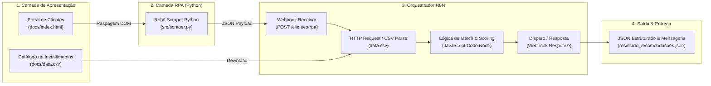

# 🏦 Santander 2026 - Automação com N8N
## 🤖 Desafio de Projeto: Criando um Processo de RPA com N8N e Python

[](https://www.dio.me)
[](https://www.santander.com.br)
[](https://www.python.org)
[](https://n8n.io)
[](LICENSE)

---

## 📌 Visão Geral do Projeto

Este repositório contém a solução completa para o **Desafio de Projeto** do bootcamp **Santander 2026 - Automação com N8N** da plataforma **DIO (Digital Innovation One)**:
> **"Criando um Processo de RPA com N8N e Python: Assistente Inteligente de Investimentos"**

O objetivo principal é construir um fluxo de automação inteligente e corporativo que:
1. **Extrai dados de clientes** (nome, email, saldo, perfil de investidor) de uma aplicação web legada utilizando um robô de **RPA em Python** (`BeautifulSoup` e `Requests`).
2. **Dispara um Webhook** estruturado para a plataforma de orquestração **n8n**.
3. **Consome o catálogo de produtos de investimentos** (Renda Fixa, Imobiliário, Renda Variável) a partir de uma base de dados (`data.csv`).
4. **Cruza os perfis de risco** com o saldo de cada correntista para gerar recomendações altamente personalizadas de investimento.
5. **Retorna e simula o disparo** de mensagens direcionadas aos canais digitais do cliente.

---

## 🏗️ Arquitetura da Solução



---

## 📁 Estrutura de Diretórios

```bash
DIO/
├── docs/
│   ├── index.html                  # Interface web simulando o portal bancário de clientes
│   └── data.csv                    # Catálogo de ativos de investimento categorizados
├── src/
│   ├── scraper.py                  # Robô RPA em Python com extração e disparo via Webhook
│   └── test_rpa.py                 # Validador local end-to-end com simulação completa
├── n8n/
│   └── workflow_rpa_n8n.json       # Workflow exportado do n8n pronto para importação
├── clientes_extraidos.json         # Base extraída pelo RPA (gerada em tempo de execução)
├── resultado_recomendacoes.json    # Relatório final com mensagens personalizadas geradas
├── requirements.txt                # Dependências Python necessárias
└── README.md                       # Documentação técnica do projeto
```

---

## ⚙️ Pré-Requisitos e Instalação

### 1. Clonar ou Acessar a Pasta do Projeto
Certifique-se de estar no diretório do projeto:
```bash
cd c:\Users\incan\Downloads\DIO
```

### 2. Instalar as Dependências Python
```bash
pip install -r requirements.txt
```

---

## 🚀 Como Executar

### Opção A: Teste Local Rápido (Sem necessidade de subir o N8N)
Para validar todo o fluxo, a leitura do HTML, o cruzamento com o catálogo CSV e a montagem das recomendações:
```bash
python src/test_rpa.py
```
*Saída esperada:*
```text
[*] Iniciando teste local integrado do projeto...
[*] Lendo arquivo HTML local: docs/index.html
[+] Total de clientes lidos: 6
[+] Total de opções de investimento: 9
[+] Sucesso! 6 recomendações geradas.
[+] Relatório exportado para: resultado_recomendacoes.json
```

### Opção B: Execução com o Robô RPA
Para executar apenas o robô de raspagem salvando os dados em formato JSON:
```bash
python src/scraper.py --no-send
```

Para enviar os dados diretamente ao Webhook do seu N8N:
```bash
python src/scraper.py --webhook "http://localhost:5678/webhook/clientes-rpa"
```

---

## 🔄 Como Importar o Workflow no N8N

1. Abra a sua instância do **n8n** (local em `http://localhost:5678` ou n8n Cloud).
2. Clique no menu lateral em **Workflows** > **Add Workflow**.
3. No canto superior direito, clique nos três pontinhos (`...`) e selecione **Import from File**.
4. Selecione o arquivo `n8n/workflow_rpa_n8n.json`.
5. Ative o workflow (**Active: ON**) para que o Webhook fique ouvindo as requisições do robô Python.

---

## 📊 Perfis de Investimento e Ativos Contemplados

| Perfil do Cliente | Ativos Recomendados | Rentabilidade Típica | Nível de Risco |
| :--- | :--- | :--- | :--- |
| **Conservador** | Tesouro Selic 2029, CDB Santander DI 102%, LCI Sustentável | 100% Selic / CDI | Baixo |
| **Moderado** | Tesouro IPCA+ 2035, FII Santander (SXRF11), Debêntures | IPCA + 6.35% a.a. | Médio |
| **Arrojado** | Santander FIC Ações Ibovespa, ETF B3 Dividendos, Fundo Macro | Retorno Variável / Alpha | Alto |

---

## 📝 Exemplo de Mensagem Gerada pelo Pipeline

> *"Olá Carlos Eduardo Silva, identificamos que seu perfil financeiro é **CONSERVADOR** com saldo de **R$ 15.000,00** disponível para aplicação. Com base na nossa análise de mercado, recomendamos alocar seus recursos em: **Tesouro Selic 2029 (100% Selic)** e **CDB Banco Santander DI 102% (102% CDI)**. Acesse o App Santander para confirmar a operação com segurança!"*

---

## 🏆 Entrega na Plataforma DIO

Para submeter o Desafio de Projeto na plataforma DIO:
- **Repositório GitHub de Referência Oficial:** `https://github.com/digitalinnovationone/dio-lab-assistente-investimentos-rpa-n8n`
- **Repositório do Aluno (Fictício/Próprio):** `https://github.com/incanderson/dio-santander-rpa-n8n-python`

---

Desenvolvido para o **Bootcamp Santander 2026 - Automação com N8N** na **DIO**.
